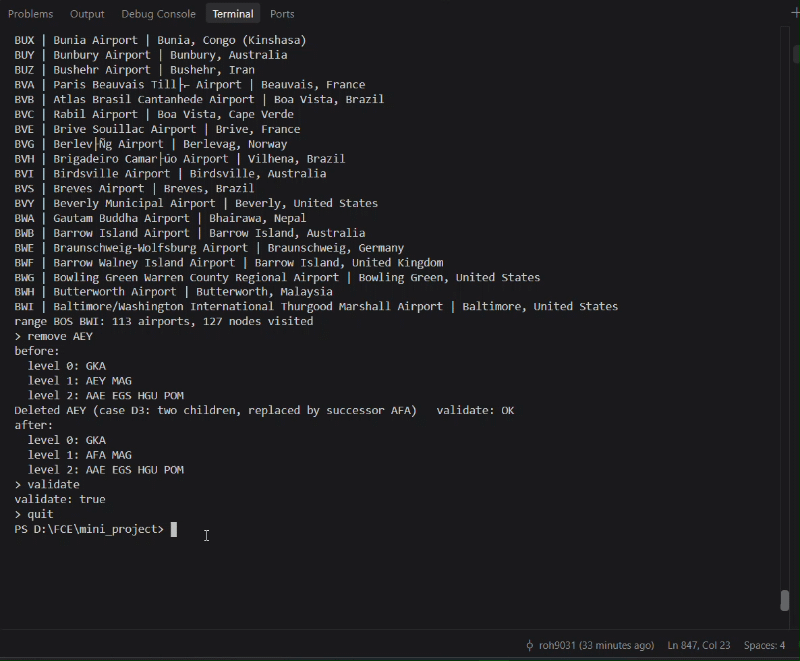

# Airport Code Lookup Service with a Binary Search Tree

**EECE 7250: Fundamentals of Computer Engineering · Northeastern University · Fall 2026 · Mini Project**

Team: Rohini Bidnurmath and Catalina Buitano

## The problem

Every flight booking, boarding pass and baggage tag identifies an airport by its three-letter IATA code (BOS for Boston Logan, JFK for New York Kennedy, DAC for Dhaka). A travel company needs a fast lookup service that, given a code, returns the airport's name, city, country and location, and that stays correct while airports are added and removed. Customer agents also need alphabetical listings and range queries such as "every code from BOS to BWI".

This project builds that service on our own binary search tree (`AirportBST`), keyed by IATA code and loaded with 6,072 real airports from the OpenFlights database. Every operation (insert, search, delete, range) runs in O(h) time, where h is the height of the tree, so the project also measures how the order in which airports are inserted changes the height.

## Repository layout

```
airport-bst-cpp/
├── src/
│   └── main.cpp                 Airport and AirportBST classes, loader, tests, interactive session
├── data/
│   └── airports.dat             OpenFlights airport data (course copy)
├── docs/
│   ├── pseudocode.md            pseudocode for every operation
│   ├── session_commands.txt     commands used for the sample run
│   ├── sample_output.txt        full output of a test run
│   └── demo.gif                 screen recording of a session
└── README.md
```

## How to build and run

You need a C++17 compiler (g++). Run every command from the repository's root folder.

**Build:**

```
g++ -std=c++17 -O2 src/*.cpp -o airports
```

**Run** (Git Bash, macOS or Linux):

```
./airports
```

**Run** (Windows PowerShell):

```
.\airports.exe
```

The program first runs the test cases for Tasks 1 to 6, then opens an interactive session with a `>` prompt.

**Save a full run to a file** (feeds the commands in `docs/session_commands.txt` to the session):

```
./airports < docs/session_commands.txt > docs/sample_output.txt                          # Git Bash
cmd /c "airports.exe < docs\session_commands.txt > docs\sample_output.txt"                # PowerShell
```

## Session commands

| Command | What it does |
|---|---|
| `find CODE` | Searches for an airport; prints the search path, the number of comparisons and the airport |
| `min` / `max` | Smallest / largest code in the tree |
| `remove CODE` | Deletes an airport; prints which deletion case was used, the top 3 levels before and after, and validates |
| `add CODE` | Adds an airport (asks for name, city and country) |
| `list` | Every airport in alphabetical code order (inorder traversal) |
| `range FROM TO` | Every airport with a code from FROM to TO, and how many nodes were visited |
| `save FILE` | Writes the codes in preorder, one per line |
| `load FILE` | Rebuilds the tree from a preorder file |
| `validate` | Checks the BST property with the range (lo, hi) method |
| `levels` | Level order of the top 3 levels |
| `stats` | Size, height and average depth |
| `rebalance` | Rebuilds the tree as a balanced tree (middle rule) |
| `help` / `quit` | Lists the commands / exits |

## Sample session

```
> find BOS
Path: GKA -> AEY -> EGS -> BUJ -> BJA -> BSK -> BOY -> BNI -> BOH -> BOO -> BOU -> BOS    (comparisons: 12)
BOS General Edward Lawrence Logan International Airport, Boston, United States

> range BOS BWI
BOS | General Edward Lawrence Logan International Airport | Boston, United States
BOU | Bourges Airport | Bourges, France
BOW | Bartow Municipal Airport | Bartow, United States
...
BWH | Butterworth Airport | Butterworth, Malaysia
BWI | Baltimore/Washington International Thurgood Marshall Airport | Baltimore, United States
range BOS BWI: 113 airports, 127 nodes visited

> remove AEY
before:
  level 0: GKA
  level 1: AEY MAG
  level 2: AAE EGS HGU POM
Deleted AEY (case D3: two children, replaced by successor AFA)   validate: OK
after:
  level 0: GKA
  level 1: AFA MAG
  level 2: AAE EGS HGU POM

> validate
validate: true
```

The full output of a test run is in [docs/sample_output.txt](docs/sample_output.txt).

### Demo



## Results

### Task 1: Load the data and build the tree

| Check | Expected | Result |
|---|---|---|
| Lines in the file | 7,698 | 7,698 |
| Airports with an IATA code | 6,072 | 6,072 |
| Lines skipped (IATA code `\N`) | 1,626 | 1,626 |
| Duplicate codes (rule I4) | 0 | 0 |
| Height (file order) | 177 | 177 |
| Average depth of a node | | 18.32 |

### Task 2: Search

| Case | Code | Comparisons | Result |
|---|---|---|---|
| The root | GKA | 1 | Goroka Airport, Papua New Guinea |
| A leaf | AAC | 5 | El Arish International Airport, Egypt |
| Deepest node in the tree | YZR | 178 | Chris Hadfield Airport, Sarnia, Canada |
| A code that does not exist | XYZ | 14 | not found |
| Smaller than every key | 000 | 4 | not found |
| Larger than every key | ZZZZ | 37 | not found |

Minimum code: **AAA** (Anaa Airport). Maximum code: **ZZV** (Zanesville Municipal Airport).

### Task 3: Delete

Each delete was run on a freshly built file-order tree, and the tree was validated after each one.

| Case | Code | What happened | Validate |
|---|---|---|---|
| D1: leaf | AAC | Removed; parent's pointer set to null | OK |
| D2: only a left child | GJT | Replaced by its left child GJR | OK |
| D2: only a right child | AAA | Replaced by its right child AAC | OK |
| D3: two children | AEY | Replaced by its inorder successor AFA | OK |
| The root (D3) | GKA | Replaced by its inorder successor GKE | OK |

A made-up airport, QQQ (Cats Buitano Memorial Airfield, Boston), was added, found with 22 comparisons, removed (D1, leaf), and then correctly reported as not found.

### Task 4: Traversals and validation

- The inorder list contains all 6,072 airports and is sorted.
- The tree was saved in preorder and loaded back: the reloaded tree has the same height (177) and the same level order.
- `validate` (range method) returned true after every insert during the build and after every delete.

### Task 5: Range queries

`range BOS BWI` returned **113 airports** (as expected) and visited only **127 of the 6,072 nodes**, because subtrees entirely outside the range are skipped.

### Task 6: The shape experiment

The same 6,072 codes were inserted in different orders, and each tree was timed on the same 10,000 random searches.

| Build order | Height | Average depth | Time for 10,000 searches | Explanation |
|---|---|---|---|---|
| File order | 177 | 18.32 | 2.98 ms | The file is mostly in ICAO-code order, which creates long runs of increasing IATA codes. Each run becomes a near-chain going right (see below). |
| Sorted order | 6,071 | 3,035.50 | 362.73 ms | Every new code is larger than all codes already in the tree, so it always goes right: the tree is a chain of n − 1 = 6,071 edges. The average depth is (n − 1) / 2 = 3,035.5, so searches are about 120 times slower. |
| Balanced (middle rule) | 12 | 10.65 | 2.05 ms | The middle element of each range becomes the root, so each level halves the range. The height is ⌊log₂ 6072⌋ = 12, the smallest possible. |
| Random shuffle (bonus) | 31 | 14.88 | 2.69 ms | A random order rarely produces long sorted runs, so the height stays O(log n). The average depth is close to the theoretical value for a random BST, 2Hₙ − 4 ≈ 14.6. The exact height depends on the random seed. |

Times were measured on our own laptop with `std::chrono` and will differ on other machines; the heights and average depths do not.

**Why is the file order so much worse than a random shuffle?**

The lines of `airports.dat` are not in random order. Our program measured that **81% of lines have a larger ICAO code than the line before** (a random order would give about 50%), so the file is mostly sorted by ICAO code. For many countries the IATA code follows the ICAO code. Canadian airports are the clearest example: ICAO `CYYZ` is IATA `YYZ`, ICAO `CYVR` is IATA `YVR`, and so on. So when the file runs through Canada's airports in ICAO order, their IATA codes arrive almost in sorted order, and each one is inserted to the right of the one before. That builds a long near-chain, a small version of the sorted-order tree.

The search path for YZR, the deepest node, shows exactly this chain:

```
GKA -> MAG -> POM -> WWK -> YAM -> YAY -> YAZ -> YBB -> YBC -> YBG -> ... -> YZH -> YZP -> YZR
```

After four steps the path is about 170 Y codes in increasing order, which is where the height of 177 comes from. Our program also found an unbroken run of 162 lines with increasing IATA codes. A random shuffle breaks these runs apart, which is why it gives a height of about 25 to 31 instead of 177.

Because every operation costs O(h), the shape matters directly: the search times above follow the average depths.

## Design notes

- **Two classes:** `Airport` holds one record (ID, name, city, country, IATA, ICAO, latitude, longitude); `AirportBST` holds the tree, with `root` private.
- **Iterative insert and search:** insert, search and delete use `while` loops. Inserting 6,072 sorted codes builds a chain 6,071 deep, which can overflow the call stack with recursion.
- **Height convention:** height counts edges, so a single node has height 0 and a chain of n nodes has height n − 1, matching the expected values in the handout.
- **Deletion with two children** copies the inorder successor (the smallest code in the right subtree) into the node, then removes the successor, which has at most one child.
- **Validation** uses the range (lo, hi) method: every node's code must lie strictly between the bounds inherited from its ancestors.
- **Save and load** use preorder: inserting codes in preorder puts every node back in its original position, so the reloaded tree has exactly the same shape.

Pseudocode for every operation is in [docs/pseudocode.md](docs/pseudocode.md).

## Data credit

Airport data from **OpenFlights.org** (`airports.dat`, [openflights.org/data.php](https://openflights.org/data.php)), published under the Open Database License (ODbL).